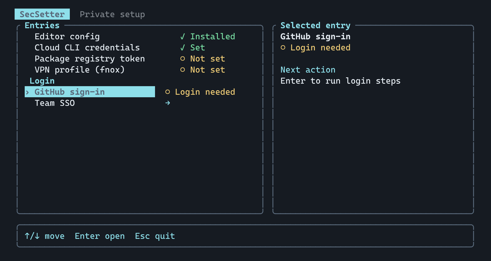

# SecSetter

**Finish setting up a machine after you sync your dotfiles.**

SecSetter gives you one terminal screen for the setup steps that still need you: install a config, paste an API token, restore a private file, or sign in to a service. The list shows what is in place and what still needs attention.



## When to use it

- **Set up a new laptop.** Install your usual configs, add a package registry token, and run your GitHub sign-in from one list.
- **Restore a private config.** Fetch a backed-up file from [fnox](https://fnox.jdx.dev/) and write it where the application expects it.
- **Repeat the same setup across machines.** Keep the SecSetter TOML config and non-secret templates in your dotfiles. Put real secrets in the application files or your secret store.

SecSetter can write a whole secret file or update a single string field in TOML, YAML, or JSON. A login action can run multiple commands in order. Status comes from local files and fields. It does not verify credentials or active sessions.

## Install

Download an archive and `SHA256SUMS` from [GitHub Releases](https://github.com/prepin/secsetter/releases).

| System | Archive |
| --- | --- |
| Linux x86-64 (AMD64) | `secsetter-x86_64-unknown-linux-gnu.tar.gz` |
| Linux ARM64 | `secsetter-aarch64-unknown-linux-gnu.tar.gz` |
| macOS Apple Silicon | `secsetter-aarch64-apple-darwin.tar.gz` |

Check the archive against `SHA256SUMS` with `sha256sum <archive>` on Linux or `shasum -a 256 <archive>` on macOS. Extract the archive. Put `secsetter` in a directory on your `PATH`.

## Quick start

1. Save this example as `secsetter.toml`:

   ```toml
   [[entries]]
   id = "example-token"
   label = "Example API token"
   kind = "secret-file"
   destination = "$XDG_CONFIG_HOME/secsetter-demo/token"
   ```

2. Validate the config and open the terminal UI:

   ```sh
   secsetter -c ./secsetter.toml validate
   secsetter -c ./secsetter.toml
   ```

3. Select **Example API token** and press Enter. Paste a dummy token in the masked prompt. Press Enter to save it. To clear it, press Delete on the entry and confirm.

The default config is `$XDG_CONFIG_HOME/secsetter/config.toml`. If `XDG_CONFIG_HOME` is unset or empty, the default is `~/.config/secsetter/config.toml`.

## Command line

Each entry has an ID for use in scripts. The `validate` command checks the config without running any of its actions.

```sh
secsetter -c ./secsetter.toml list
secsetter -c ./secsetter.toml set example-token < ./token.txt
secsetter --help
secsetter skill
```

`secsetter skill` prints the [config-writing guide](skills/secsetter/SKILL.md). It contains examples for templates, secret fields, fnox restores, and login readiness checks. Fnox restores require `fnox` on `PATH`.

## Contributing

Use `cargo test --locked` to run the test suite. For bug reports and feature requests, open a [GitHub issue](https://github.com/prepin/secsetter/issues).

## Release

Update the version in `Cargo.toml` and refresh `Cargo.lock`. Merge the changes into `master`. When CI passes, push a matching version tag such as `v1.0.0`. GitHub Actions builds and tests all three targets before it publishes the archives and checksums.

## License

SecSetter is available under the [MIT License](LICENSE).
